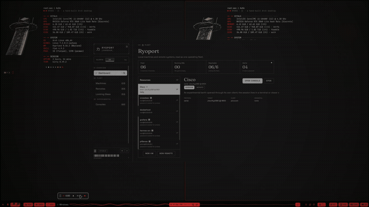

<p align="center">
  <h1 align="center">Windows</h1>
  <p align="center">
    
    
    
  </p>
</p>

A Ryoku shell plugin (`window-stash`). It lists the open windows on the bar and
lets you park any of them out of sight with one click, bring it back to the
workspace it came from, or close it.

It reads the window list from the window-manager seam (`ryoku wm state`) and acts
through it (`ryoku wm act`), so the list, focus and close behave the same on
Hyprland and on niri. Hiding is the one compositor-specific feature: it is gated
on the `specialWorkspace` capability that `ryoku wm caps` reports, exactly the
way Ryoku's own `ryoku-workspace` helper gates it, and it is left out of the
panel on a compositor that has no scratchpad.



## Why it exists

Hyprland 0.56 has **no `minimize` dispatcher** (`hl.dsp.window.*` has close, kill,
float, fullscreen, move, swap, pin … and no minimize). The working substitute is
the special workspace: move a window into one and it leaves the screen, move it
back and it returns.

Ryoku already ships that as a keybind, `Super+H` (`ryoku-workspace hide`), but it
acts on the **focused** window. A window parked in a special workspace cannot be
focused, so pressing `Super+H` again does not bring *it* back -- it parks whatever
is focused instead. Recovering a specific window means `Super+Alt+H`, focusing it,
`Super+H`, then hiding the scratchpad again.

This plugin removes the focus dependency: it addresses every window by its
`address`, so hide and show are symmetric and always act on the window you
clicked.

## How a window is parked

It goes to the special workspace named after its own workspace:
`special:stash-3` for a window that came from workspace 3. The home workspace
travels inside the name, so **no state file is needed** and the mapping survives a
shell restart -- unlike Ryoku's own helper, which restores to whatever workspace
is current.

## What it runs, reads and writes

| Item | Detail |
| --- | --- |
| Runs | `ryoku wm state` (poll), `ryoku wm caps` (capability gate, on start and on every panel open), `ryoku wm act window.close\|window.focus` (on an explicit click), `bin/stash.sh`, `bin/restore.sh` (only where the scratchpad capability exists) |
| External commands | `ryoku`, `bash`, `hyprctl`, `jq`, `sed`, `grep` -- declared in `dependencies.commands` |
| Reads | `ryoku wm state` (windows: id, appId, title, workspace), `ryoku wm caps` (capabilities); the hide scripts read `hyprctl clients/monitors` after the gate |
| Writes | Nothing at all. No state file, no config, no cache. Settings go through `pluginApi.saveSetting` only |
| Network | None. `capabilities.network` is absent on purpose |
| Privileged | None. No `pkexec`, no `sudo` |
| Dispatchers used | Through the seam: `window.close`, `window.focus`. For hiding only: `hl.dsp.window.move`, `hl.dsp.workspace.toggle_special`, `hl.dsp.focus` |

### What the buttons do

- **HIDE** parks the window in its own special workspace; **SHOW** brings it back
  to the workspace it came from. Both appear only where the scratchpad capability
  exists -- on a compositor without one the panel says so and offers the rest.
- **Clicking a row's name** focuses that window (`window.focus`), which is how a
  buried window comes back without hiding anything.
- **CLOSE** ends the window, exactly like its own close button: a program with
  unsaved work will lose it. There is no confirmation step, on purpose -- the
  button is a direct action, not a dialog.

Close and focus are seam actions: the provider either performs them or reports
the failure, so there is no silent success to detect. The hide scripts still
verify after their dispatch, because `hyprctl` answers `ok` and exits 0 even for
an address that no longer exists.

### Scope of the list

Included: every window `ryoku wm state` reports. Excluded on purpose: windows on
special workspaces other than the plugin's own `special:stash-*` ones (Ryoku's
overlays such as the share bar), so the list stays about your normal windows.

The seam does not report whether a window is fullscreen, so a fullscreen window is
listed like any other. Hiding one is allowed, but a fullscreen client and a
scratchpad do not mix well -- close it or leave fullscreen first.

## Where it sits on the bar

The bar order belongs to the rice, not to the plugin: `~/.config/ryoku/shell.json`
holds `qsbar.layout`, and applying a rice rewrites it. A rice that does not name
`window-stash` in its own layout therefore drops it to the front of the left
section. Put it back and keep it there with:

```
ryoku-shell bar move window-stash --section left --after memory
```

The clean fix is to include `window-stash` in the rice's layout (or to re-save
the rice after positioning it), so the next apply carries the position over.

## Settings

| key | type | default | description |
| --- | --- | --- | --- |
| `showLabel` | toggle | `true` | Show the `Windows` label beside the state mark |
| `poll` | int | `3` | Seconds between window-list refreshes (2-30) |

The list freezes while the panel is open, so a refresh can never rebuild the rows
between a click's press and release. It refreshes once when the panel opens and
once after each action.

## Build, check, install

```
ryoku plugin validate .
ryoku plugin add . --bar --yes
```

## Preview

`assets/preview-widget.png` is a real capture of the widget on the QS Bar: the
state mark and the `Windows` label sitting between the system readouts and the
music pill, cropped from a full-width bar screenshot and enlarged 3.2x.

## Reviews and updates

The plugin is community-made (`official` is false). Fixes ship as a new
`version` in `manifest.json`: Ryostore compares versions, so a change without a
version bump never reaches an installed copy.

## Author

root-sec <root-secyrity@users.noreply.github.com>: this plugin is community-made (`official`
is false).
